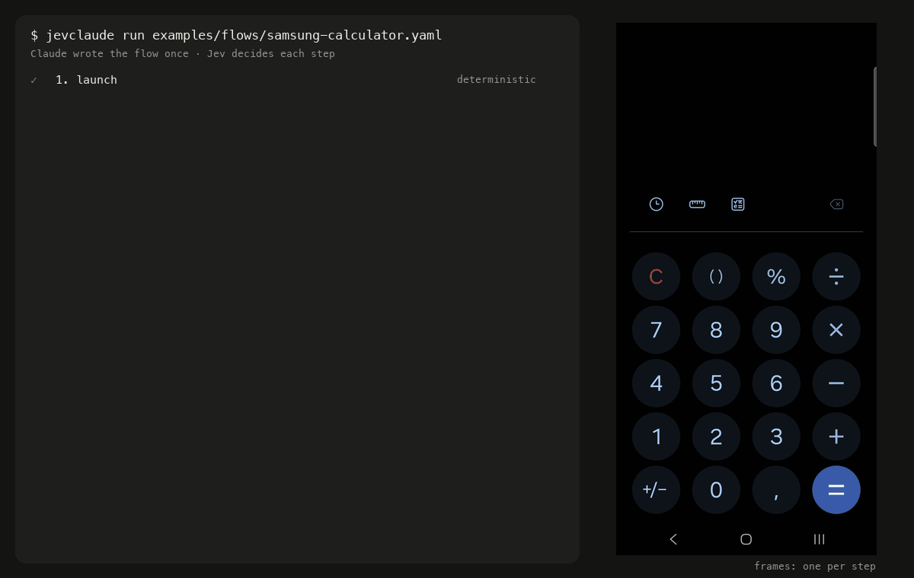

# JevClaude

[](https://www.npmjs.com/package/jevclaude)
[](https://github.com/Yupol02/jevclaude/actions/workflows/ci.yml)
[](https://www.npmjs.com/package/jevclaude#provenance)
[](LICENSE)


**Mobile app testing for Claude Code that doesn't burn your tokens.** Android is verified on a real phone; iOS (simulator) is implemented but still experimental.

Claude writes a test flow once. A local runner drives the device. [TypeSafe Jev](https://docs.typesafe.ai), a small structured-decision model, makes the per-step calls in about 200 ms each:
- which element to tap
- whether the step passed
- whether an error is showing
- whether the action is risky

A replay cache makes re-runs model-free. Claude only hears back when something fails or Jev isn't sure, and it can then decide and **resume the run where it stopped**.




```
Claude Code ──(MCP: run_flow / resume_flow)──▶ Runner ──▶ Driver
     ▲                                           │          ├─ Android: adb + UiAutomator2 server
     │ short report, only on stop                │          └─ iOS: WebDriverAgent + simctl
     │                                           ├─ 1. deterministic: exact id/text, logcat/crash reports, text checks, spinners
     │                                           ├─ 2. replay cache: last run's selector (self-heals if it's gone)
     └───────────────────────────────────────────├─ 3. Jev: choice(element) · yes/no(passed? error? risky? permission button?)
                                                 └─ 4. below threshold → paused "uncertain" → Claude decides
```

[Türkçe README](README.tr.md) · [Architecture](docs/architecture.md) · [Flow reference](docs/flow-reference.md) · [How it compares](docs/comparison.md)

## Why

When Claude Code tests an app by driving the device itself, every step is a full LLM turn: screenshot, read, think, act. That's slow and expensive. Most of those decisions are small and typed:
- "Which of these 30 elements is the login button?"
- "Does this screen show the cart: yes or no?"

| | Plain Claude Code + adb | JevClaude |
|---|---|---|
| What the model sees | screenshots | compact accessibility tree (`[3] Button "Log in" id=btn_login {clickable}`) |
| Per-step decision | Claude turn | exact match → cache → one Jev call (choice and risk asked together) |
| Re-running a passing flow | the same cost again | replay cache, zero model calls for element picks |
| Risky actions (buy, delete, send) | whatever the model decides | blocked by default; the user must approve |
| AI assertions | — | `expect:` **fails the test** below threshold; the uncertain zone goes back to Claude |

Jev input costs about $0.042 per million tokens, and output is free.

**Measured, same phone, same task** (details in [Benchmark](#benchmark)):

| Task | JevClaude (median) | Plain Claude Code (median) | Per run |
|---|---|---|---|
| Samsung Calculator: 12 × 7, check the preview, clear (3 runs each, all passed) | **4.9 s · ≈ $0.00013** | 52.6 s · ≈ $0.19 | ~11× faster, ~1,400× cheaper |
| Real Compose app: create an event (3 runs each, 2/3 passed each; older JevClaude, slow backend) | 47 s · ≈ $0.0008 | 90 s · ≈ $0.28 | ~1.9× faster, ~350× cheaper |

All per run, once the flow is written. The samples are small; read the caveats before quoting them.

## Quick start

Prerequisites: Node 20 or newer.
- Android: `adb` and a phone with USB debugging, or an emulator.
- iOS: macOS with Xcode and a booted simulator.

```bash
npm install && npm run build
node dist/cli.js init            # jevclaude.config.yaml, flows/smoke.yaml, .env
# add TYPESAFE_API_KEY (or CLOUDFLARE_ACCOUNT_ID + CLOUDFLARE_API_TOKEN) to .env
node dist/cli.js setup android   # optional: UiAutomator2 server → ~0.2 s screen reads + Unicode typing
node dist/cli.js setup ios       # boots a simulator if needed, installs WebDriverAgent
node dist/cli.js doctor          # checks tools, devices, servers and the Jev key
node dist/cli.js run examples/flows/settings-smoke.yaml --html report.html
```

### Use it in your project

1. In your app's repository, create the starter files:
   ```bash
   npx jevclaude init     # jevclaude.config.yaml, flows/smoke.yaml, .env
   ```
2. Put `TYPESAFE_API_KEY` and any test-account values (`TEST_EMAIL`, …) in `.env`. `init` creates it; keep it out of git.
3. Connect a phone with USB debugging and run:
   ```bash
   npx jevclaude setup android && npx jevclaude doctor
   ```
4. Connect Claude Code to it (next section). Ask Claude to test a feature; it writes the flow into `flows/` and runs it.
5. Commit `flows/` and `.jevclaude/cache/`, so CI re-runs need no model calls for element picks. Run them on every PR with [examples/ci/github-actions-android.yml](examples/ci/github-actions-android.yml).

### Use from Claude Code

```bash
claude mcp add jevclaude -- npx -y jevclaude mcp
```

Then ask: *"test the login flow on my phone"*. The bundled skill (`.claude/skills/test-feature`) tells Claude to write one flow, call `run_flow` once, and read only the report.

MCP tools:

| Tool | What it does |
|---|---|
| `list_devices` | Android devices and booted iOS simulators |
| `snapshot` | the current screen as compact text (cheaper than a screenshot) |
| `run_flow` | runs a YAML flow; returns a short report and, if it stopped, a `run_id` |
| `resume_flow` | `pass` / `retry` / `fail` for the stopped step, then continues without relaunching |

## Flow example

```yaml
name: login happy path
app: com.example.shop          # Android package or iOS bundle id
fresh_start: true
permissions: allow             # system permission dialogs: allow | deny | stop (default)
steps:
  - launch
  - if_visible: "What's new"
    then: [ { tap: { text: "Close" } } ]
  - tap: "Log in button on the welcome screen"            # cache → Jev; scrolls to find it
  - type: { into: "email field", text: "${TEST_EMAIL}" }  # ${VAR} from env/.env
  - type: { into: { id: password }, text: "${TEST_PASSWORD}", submit: true }
  - wait_for: "Home"                                      # deterministic, up to 10 s
  - expect: "The user is signed in and sees their name"   # Jev judges the screen
  - see: "Siparişlerim"                                   # Unicode is fine
    optional: true
```

The full syntax is in [docs/flow-reference.md](docs/flow-reference.md). Maestro users can convert flows with `jevclaude import-maestro` and `export-maestro`.

## CLI

```bash
jevclaude run flows/ --junit junit.xml --html report.html   # every *.yaml in flows/
jevclaude run flows/ --devices R58M123,emulator-5554        # same flows on several devices, in parallel
jevclaude run login.yaml --trace --record                   # screenshot every step + video
jevclaude run login.yaml --update-cache                     # re-resolve targets and refresh the cache
jevclaude snapshot --platform ios                           # what Jev would see
jevclaude import-maestro login.maestro.yaml -o flows/login.yaml
```

Reports are written to `reports/<time>-<flow>/`:
- `report.json`
- `report.html`: self-contained, with step timeline, Jev probabilities and screenshots
- `step-NN.png`
- `run.mp4`, when `--record` is set

Exit codes: 0 if everything passed, 1 otherwise.

## Web pages (Chrome)

When Chrome is in front, every screen read also reads the visible tab through Chrome DevTools:
- **Connection:** `adb forward` to Chrome's `chrome_devtools_remote` socket. The tab is picked by the address bar.
- **Reading:** a small in-page script lists visible text, links, buttons and inputs. Elements covered by an overlay are skipped.
- **Mapping:** page elements are mapped to screen pixels and merged into the tree as `Web.a "largest city"`, `Web.input "Search Wikipedia" id=web:searchInput`, …

So `see:`, `wait_for:`, `tap:`, `type:`, `expect:` and Jev's element picks work on page content. Web inputs are typed with DevTools `Input.insertText` and submitted with a DevTools Enter, so Unicode works on any backend.

```yaml
app: com.android.chrome
steps:
  - open: "https://en.wikipedia.org/wiki/Istanbul"   # new tab
  - wait_for: "Istanbul (disambiguation)"
  - tap: { text: "largest city" }                    # scrolls the page if needed
  - tap: { id: "web:searchIcon" }
  - type: { into: "the Wikipedia search input", text: "İstanbul Boğazı", submit: true }
  - expect: "Wikipedia shows an article about the Bosphorus"
```

Full example: [examples/flows/chrome-web.yaml](examples/flows/chrome-web.yaml).

**Results.** It passed 6/6 times on the UiAutomator2 backend at 10.5–12.4 s, and once on the adb backend at 36 s.

**Safety.** Before tapping a web element, the runner checks that the point isn't on the browser's own UI (address bar, menu). If it is, it refuses to tap and stops as `uncertain`. This rule was added after an early build mis-mapped a tap onto Chrome's menu. `JEVCLAUDE_WEB=off` turns web reading off.

## Decisions and thresholds

| Question | How | Rule (configurable in `jevclaude.config.yaml`) |
|---|---|---|
| Which element is "the login button"? | exact match → cache → Jev `choice` over on-screen elements | confidence below 0.6 → `uncertain`; `none` → scroll, then `failed` |
| Does the screen match `expect:`? | Jev `noul` | p ≥ 0.80 passed · p ≤ 0.15 failed · otherwise `uncertain` → Claude. On the phone, correct screens scored 0.70–0.98 (mostly ≥ 0.80) and wrong ones 0.01–0.19 |
| Is an error or crash visible after an action? | crash logs on failure and at the end; Jev `noul` only when error-like text or a dialog is on screen (`error_check: auto`) | crash or p ≥ 0.85 (`error_fail`) → `failed` |
| Is this tap or type risky (money, install/uninstall, deletion, messaging, account/security)? | Jev `noul`, asked together with the pick and cached once it's known to be safe | p ≥ 0.5 → `blocked` until the user allows it. Play Store "Install" scored 0.81–0.87; back / scroll / screenshots 0.03 |
| Permission dialog? | package / alert detection, button by regex, then Jev | per-flow `permissions:` policy |
| Still loading? | progress-indicator detection | wait up to 15 s |

Screen text is untrusted. It is wrapped in `<<<SCREEN … SCREEN>>>` and every question tells Jev to treat it as data, so text inside the app under test can't steer decisions. Before it leaves the machine, e-mail addresses, phone numbers and card/IBAN-like numbers are masked (`<email>`, `<phone>`, …).

## Status and limits

- **What's verified:**
  - 65 unit tests, all run on recorded Android (uiautomator and UiAutomator2) and iOS (WebDriverAgent) screens.
  - The live Jev API is checked with `npm run jev:smoke`.
  - **Android, real device:** Samsung Galaxy S22 Ultra, Android 16, Turkish UI. Verified there:
    - both backends, the replay cache and `run_flow` → `resume_flow` over MCP
    - a production Jetpack Compose app, including Unicode typing into Compose fields and date/time fields that have no accessibility label
    - stock apps: Calculator, Clock, Settings and Play Store, all passing 3/3 at 4.6–7.7 s per run
    - negative controls: wrong expectations fail at p = 0.01
    - the risk guard on a real Play Store page: "Install" is blocked, harmless actions are allowed (asked without tapping)
    - results are below
- **What's not verified yet:**
  - iOS on a live simulator.
  - Permission dialogs on a device (covered by unit tests only).
  - See the [e2e checklist](CONTRIBUTING.md#end-to-end-checklist).
- **Jev's weak spots:** counting, arithmetic and multi-hop reasoning. Check numbers with `see:`.
- **Literal reading:** Jev takes wording literally. "Results are shown *under* the search field" correctly scored 0.19 on a phone whose search bar sits *below* the results. Describe what must be true, not where it is.
- **Text-only:** canvas, games and Flutter apps without semantics produce empty trees. Those need Claude with screenshots.
- **Web pages in Chrome are read through Chrome DevTools** (see [Web pages](#web-pages-chrome)), because Chrome's accessibility tree exposes page content only some of the time. WebViews inside other apps aren't covered yet: they need `WebView.setWebContentsDebuggingEnabled(true)` and a per-app socket.
- **Unlabeled controls:** a tap target with no label gets the text it touches as a `near="…"` hint (e.g. a date field's "Date is required" message). It works, but adding a `contentDescription` / `semantics` label to the app is more reliable, and better for accessibility.
- **Don't record the screen in parallel:** a `screencap` loop running next to a test slowed the phone enough to break UiAutomator2 calls. Use `--trace` (one screenshot per step) or `--record`.
- **Android typing:** the adb-only backend types ASCII only. `setup android` enables Unicode.
- **iOS:** simulator only for now. Real devices need WebDriverAgent signing.

## Benchmark

`npm run bench -- --runs 3 --baseline` runs each scenario in `bench/scenarios.json` four ways:
- JevClaude, cold cache
- JevClaude, warm cache
- plain `claude -p` driving `adb`
- optionally Maestro

It prints pass rate, median time, tokens and cost.

### 0.3.0 final check (stock apps, same phone, stable cable)

Each flow was run 3 times; run 1 had a cold cache for new flows. All 15 runs passed.

| Flow | Time per run | Jev calls | Notes |
|---|---|---|---|
| [samsung-calculator](examples/flows/samsung-calculator.yaml) | 4.6–5.4 s | 3–6 | |
| [samsung-stopwatch](examples/flows/samsung-stopwatch.yaml) | 5.0–6.3 s | 0–5 | includes a 1.5 s `wait` |
| [settings-search-unicode](examples/flows/settings-search-unicode.yaml) | 4.7–7.7 s | 1–3 | types `parlaklık` |
| [settings-smoke](examples/flows/settings-smoke.yaml) | 5.8–6.3 s | 3–6 | 3 scrolls |
| [playstore-search](examples/flows/playstore-search.yaml) | 5.1–5.4 s | 1 | `expect` scored 0.82–0.84: `uncertain` at the old 0.85 threshold, passed at 0.80 |

Negative controls: "the result preview shows 85" on a screen showing 84, and "a WhatsApp chat is open" in Settings, both failed at p = 0.01. One earlier Play Store run stopped with "error visible": the store really showed "Bir sorun oluştu / Sunucu hatası" (a server error), and the next runs passed.

### Stock app: JevClaude vs plain Claude Code (0.2.5)

Task: in Samsung Calculator, enter 12 × 7 with the on-screen keys, check that the live preview shows 84 *without* pressing "=" (so nothing goes into the calculator history), then clear. Plain Claude Code (`claude -p`, adb only, screenshots allowed) got the same instructions. Each method ran 3 times on 2026-11-25 on a Galaxy S22 Ultra.

| | JevClaude ([samsung-calculator.yaml](examples/flows/samsung-calculator.yaml); run 1 cold cache) | Plain Claude Code |
|---|---|---|
| Passed | 3/3 | 3/3 (by its own report; each said it never pressed "=") |
| Run times | 5.5 · 4.9 · 4.9 s | 53.6 · 52.6 · 39.2 s |
| **Median** | **4.9 s** | **52.6 s** |
| Tokens per run | 3.2–9.4 k (Jev) | 0.48–0.78 M (Claude, mostly cache reads) |
| **Median cost** | **≈ $0.00013** | **≈ $0.19** |
| Model | jev-1.14.0, 3–6 calls | claude-sonnet-5-5, 15–18 turns |

Plain Claude read the screen with `uiautomator dump` (~2.3 s per read) and spent a model turn on every step. JevClaude replays a cached flow: three of its ten steps are exact ids, and only the risk check and the one `expect:` reach Jev.

### Real app: JevClaude vs plain Claude Code

On 2026-11-25 the same task was run 3 times with each method on a Galaxy S22 Ultra (Android 16). The task is "add a new event": title, date picker (30 Nov 2026), content, time picker (18:00), then *create*, then check it is listed. The app is a real Jetpack Compose app that isn't public, so its screens aren't shown here.

Every claimed pass was checked independently by reading the event list afterwards. The checker found the title, date and time, with exactly one copy.

| | JevClaude (adb backend, J1 cold cache, J2–J3 warm) | Plain Claude Code (`claude -p`, adb + screenshots) |
|---|---|---|
| Run times | 47.4 · 48.1 · 45.5 s | 159.5 · 78.5 · 89.6 s |
| **Median time** | **47.4 s** | **89.6 s** |
| Passed on its own | 2/3: J2 stopped as `uncertain` (p = 0.84) on a correctly filled form | 2/3: C1 failed, and the phone also dropped off USB during it |
| False passes | 0 | 0 |
| Tokens per run | 16–21 k (Jev) | 0.63–1.74 M (Claude, mostly cache reads) |
| **Median cost** | **≈ $0.0008** | **≈ $0.28** (range $0.25–0.43) |
| Model | jev-1.14.0, 18–24 calls | claude-sonnet-5-5, 23–49 turns |

What this does and doesn't show:
- **It's per run, after the flow exists.** Writing and debugging this flow took several iterations, which this table doesn't count. Plain Claude needed no flow. JevClaude pays off when the same test runs again: every PR, every release.
- **The sample is small.** One app, one task, 3 runs each.
- **JevClaude ran on the slow backend** (~2.3 s per screen read). The UiAutomator2 backend couldn't type into Compose fields until 0.2.3. With it, a 19-step version of the same form, filled but not saved, now takes 26–33 s. The create flow hasn't been re-measured on it.
- **Plain Claude made a mistake.** In C1 it opened a different event by accident; it only looked and went back. It also had taps land under the on-screen keyboard. 0.2.3 hides the keyboard before such taps.

### Stock apps (Samsung, Turkish UI)

Each flow was run 3 times on the same phone with the UiAutomator2 backend. Run 1 has a cold cache; runs 2–3 are warm. None of them leaves data behind: the calculator never presses "=", so nothing goes into its history, and the stopwatch is reset and the app returned to its Alarm tab.

| Flow | Passed | Time | Jev calls | Tokens | Cost / run |
|---|---|---|---|---|---|
| [samsung-calculator.yaml](examples/flows/samsung-calculator.yaml): 12 × 7, check the preview shows 84 | 3/3 | 13.7–14.9 s | 10–13 | 10–16 k | ≈ $0.0004–0.0007 |
| [samsung-stopwatch.yaml](examples/flows/samsung-stopwatch.yaml): start, stop, reset, back to Alarm | 3/3 | 13.9–15.5 s | 6–11 | 4.5–10 k | ≈ $0.0002–0.0004 |
| [settings-search-unicode.yaml](examples/flows/settings-search-unicode.yaml): search Settings for `parlaklık` | 3/3 | 14.7–15.9 s | 6–8 | 4.6–6.7 k | ≈ $0.0002–0.0003 |

#### Speed work: about 2× faster per run

Profiling the calculator run (13.9 s) showed that most of the time went to waiting and checking, not to deciding:

| Where the time went (before) | | Change |
|---|---|---|
| UiAutomator2 waited for the UI to go idle before every read | 283 ms/read | `waitForIdleTimeout: 0`; the runner checks stability itself (two identical reads, digits ignored) |
| Fixed settle sleep after every action | 350 ms | 100 ms on fast drivers (`fast_settle_ms`) |
| "Is an error visible?" Jev call after every action | ~240 ms each | `error_check: auto` asks only when error-like text (error, failed, hata, tekrar dene, …) or a dialog is on screen; `always` keeps the old behaviour |
| Keyboard probe (`dumpsys input_method`) before taps in the lower half | ~250 ms each | only after a text field was tapped or typed into |
| `logcat` crash check after every step | ~90 ms each | on a failing step and once at the end |
| Taps and swipes through `adb shell input` | ~120 ms per tap | through the UiAutomator2 server (`gestures/click`, W3C actions): ~65 ms; adb as fallback |
| A confirmation read after every action | ~125 ms | skipped when the first read shows the same structure as before the action (only digits changed, e.g. a calculator key). If the next target is then missing, the screen is re-read once before Jev or scrolling is involved |

Results with a warm cache, 3 runs each, same phone:

| Flow | Before | Round 1 | Round 2 (taps via server, quick settle) | Jev calls before → after |
|---|---|---|---|---|
| samsung-calculator | 13.7–14.9 s | 5.7–7.4 s | **5.1–5.9 s** | 10 → 3 |
| samsung-stopwatch (includes a 1.5 s `wait`) | 13.9–15.5 s | 6.2–6.5 s | **5.7–6.2 s** | 6 → 0 |
| settings-search-unicode | 14.7–15.9 s | 6.6–7.7 s | **6.4–7.0 s** | 6 → 1 |
| settings-smoke (3 scrolls) | 13.7 s | — | **6.5–7.3 s** | 6 → 3 |

**Round 2 reliability.** Round 2 counted 18 passes in 21 runs. The other 3 runs, plus one 19.5 s outlier, coincided with USB reconnects: adb's `transport_id` went from 9 to 29 during the session. A reconnect kills the UiAutomator2 server. The driver now retries the start once, then falls back to `uiautomator dump`, but the dump can't type Unicode, so those runs stop with a clear error. With a stable cable, 6 back-to-back calculator runs all passed in 5.5–5.7 s.

Two notes on this run:
- **Step time is now mostly the device.** About 0.5 s per step goes to the screen read (~125 ms), the tap (~65 ms) and the app's own reaction. Jev is involved only on cache misses, risk checks and `expect:`.
- **A dead UiAutomator2 server slowed every read.** One stopwatch run right after a USB reconnect took 92 s, because the server had died and each read timed out before falling back. The driver now restarts the server once, or switches to `uiautomator dump` for the rest of the run. Killing the server mid-run on purpose now costs about 1 s; the run still passed in 5.8 s.
- **The real-app comparison above predates these changes.** It was also measured on the slow adb backend, so it hasn't been re-run with them.

These pass rates came after fixes. The first attempts surfaced two JevClaude bugs and two badly written flow steps:
- **Bug: selected tabs.** A tab that is already selected isn't marked clickable, so "the Stopwatch tab" found nothing. Fixed: selected elements are now tap candidates.
- **Bug: running timers.** A running timer changes the screen on every read, so the runner waited for its settle cap after every action, up to 26 s for one step. Fixed: settling ignores digits; the worst step is now about 3 s.
- **Flow wording: two claims in one `expect`.** "shows 12×7 and 84" scored 0.70–0.76 because the app writes "12 Çarpı 7". One claim ("the preview shows 84") passes.
- **Flow wording: number comparisons.** "stopped and shows a time greater than zero" scored 0.73–0.83 on a correct screen. Even "The stopwatch is paused" scored only 0.80–0.83. `see: "Sürdür"`, the Resume button that only exists while paused, is exact. When a state has a visible label, check the label.

### Measured so far: Android Settings

These are single runs on a Samsung Galaxy S22 Ultra (Android 16, Turkish UI) on 2026-11-25, with Jev `jev-1.14.0` through the TypeSafe API. The flows are [settings-smoke.yaml](examples/flows/settings-smoke.yaml) (5 steps; the target is found after 3 scrolls) and [settings-search-unicode.yaml](examples/flows/settings-search-unicode.yaml) (7 steps).

| What | Result |
|---|---|
| Screen read, `uiautomator dump` (adb backend) | 2.28–2.34 s (5 reads) |
| Screen read, UiAutomator2 backend | 0.12–0.21 s (5 reads; the first read right after a scroll can take up to 2.2 s while the UI settles) |
| settings-smoke, adb backend, no cache | passed · 22.9 s · 9 Jev calls · 9,574 tokens · ≈ $0.0004 |
| settings-smoke, UiAutomator2, cold cache | passed · 15.2 s · 9 Jev calls · 9,580 tokens |
| settings-smoke, UiAutomator2, warm cache | passed · 13.7 s · 6 Jev calls · 5,461 tokens |
| settings-search-unicode (types `parlaklık`) | passed · 11.0–11.7 s · 6 Jev calls · ≈ 4,680 tokens |

| fill-event-form, real Compose app, UiAutomator2 (19 steps, not saved) | passed · 26.0–33.2 s · 18–21 Jev calls · ≈ 16–19 k tokens |

## Development

```bash
npm test             # vitest
npm run coverage     # thresholds: 80% lines/functions/statements, 70% branches
npm run lint         # biome
npm run jev:smoke    # live Jev check against a recorded screen (needs a key)
```

See [CONTRIBUTING.md](CONTRIBUTING.md) and [SECURITY.md](SECURITY.md).

## License

MIT. Device servers are installed at runtime from their upstream releases:
- [appium-uiautomator2-server](https://github.com/appium/appium-uiautomator2-server) (Apache-2.0)
- [WebDriverAgent](https://github.com/appium/WebDriverAgent) (BSD-3-Clause)
